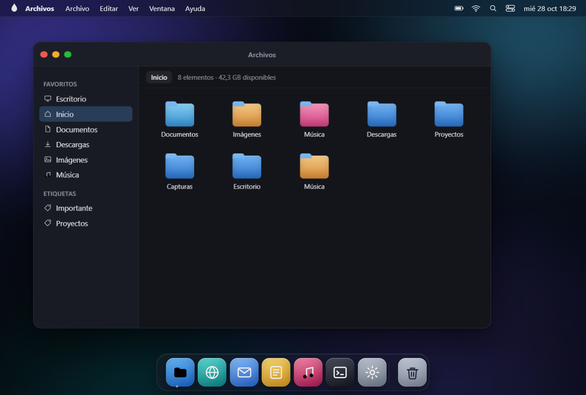
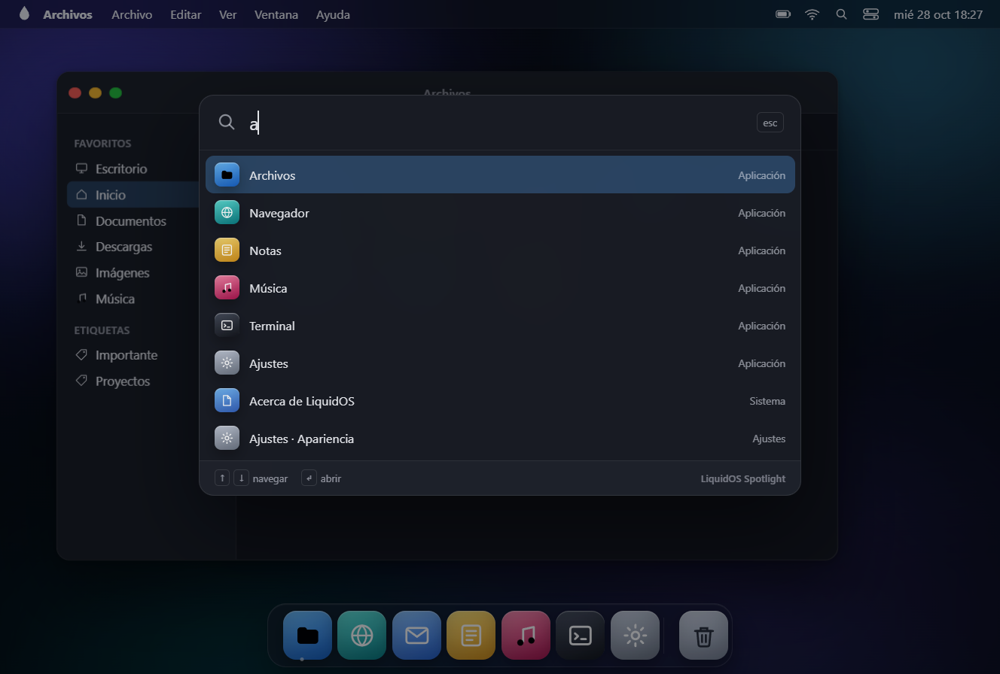
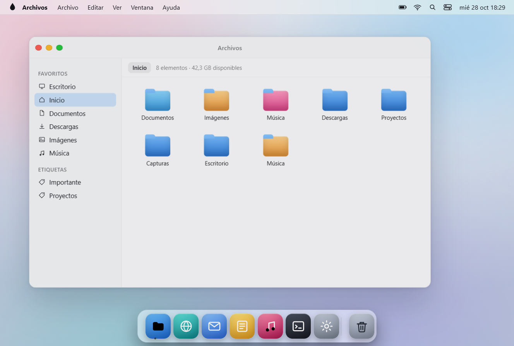
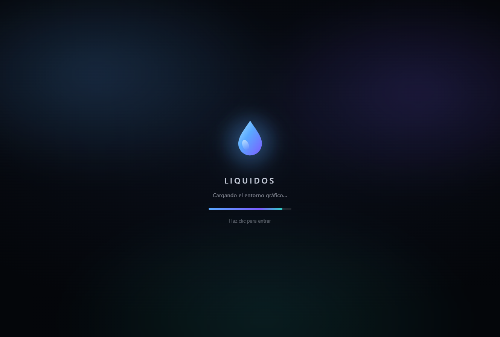

# LiquidOS

**Una distribución de Linux basada en Debian 12 con un escritorio cuidado al detalle, inspirado en macOS.**

LiquidOS no es un clon de macOS: es una distribución real (kernel Linux, paquetes Debian, GNOME),
con una capa de marca y configuración propia que busca la misma sensación de calma visual:
barra de menús translúcida, dock inferior con magnificación, ventanas con semáforos a la izquierda,
tipografía Inter, modo claro/oscuro y un arranque silencioso con splash propio.

> Estado: **1.0 «Torrente» — alpha de desarrollo**. El árbol de compilación está completo y la ISO
> se genera con GitHub Actions, Docker o WSL (ver más abajo). Todavía no se ha validado en hardware
> real: pruébala siempre en una máquina virtual antes de instalarla.



<p align="center"><em>Vista previa interactiva (HTML/CSS/JS) del escritorio LiquidOS en modo oscuro.</em></p>







<p align="center"><em>Arranque con splash propio: logo flotante, puntos en secuencia y barra de progreso.</em></p>

---

## Lo que ya está hecho

| Pieza | Estado |
|---|---|
| Vista previa interactiva del escritorio (web) | ✅ lista, sin dependencias |
| Árbol de compilación con `live-build` (Debian 12) | ✅ listo |
| Identidad del sistema (`/etc/os-release`, hostname, shell zsh) | ✅ |
| Tema macOS: WhiteSur GTK, iconos y cursores | ✅ con respaldo a Adwaita si no hay red |
| Dock inferior (Dash to Dock) y botones de ventana a la izquierda | ✅ |
| Fondos vectoriales propios (claro y oscuro) | ✅ |
| Splash de arranque Plymouth + tema GRUB | ✅ con progreso real |
| Animaciones de sistema (ventanas, Dock, Spotlight, arranque) | ✅ |
| App de bienvenida (GTK3) y guía de atajos | ✅ |
| Instalador Calamares | ⚠️ experimental |
| Repositorio propio de paquetes / actualizaciones | 🔜 pendiente |

---

## Ver el escritorio ahora mismo (sin compilar nada)

```bash
node scripts/preview.mjs
# abre http://127.0.0.1:4173
```

O simplemente abre `preview/index.html` en el navegador. Es una demo funcional y **todos los controles responden**:

- **Dock** con magnificación, indicadores de app abierta y rebote al abrir; iconos de tamaño ajustable.
- **Ventanas** arrastrables, con efecto genio al minimizar, doble clic para maximizar y menú contextual del escritorio.
- **Barra de menús** operativa (menú de LiquidOS, Archivo, Editar, Ver, Ventana y Ayuda) con paneles de Wi-Fi, batería, calendario y bloqueo/apagado.
- **Spotlight** con `Ctrl + Espacio` (flechas + Enter): busca apps, ajustes, documentos y acciones reales.
- **Centro de control** con Wi-Fi, Bluetooth, No molestar, brillo, volumen, luz nocturna y **modo claro/oscuro**.
- **Iconos del escritorio** que abren carpetas, notas, capturas y la ISO.
- **Apps de muestra totalmente interactivas**: Archivos (navegación, búsqueda y vista previa), Navegador (pestañas, historial y descargas), Correo (leer, responder, archivar, enviar), Notas (crear, editar y borrar), Música (reproducción, lista y volumen), Terminal (comandos reales) y Ajustes (Wi-Fi, apariencia, Dock, sonido y pantalla).
- **Arranque cinematográfico** de 2,6 s (se puede saltar con clic o tecla).

> La demo es HTML/CSS/JS y no forma parte de la ISO: sirve para iterar el diseño rápido.

---

## Compilar la ISO

Requisitos: Docker (recomendado) **o** Debian 12/Ubuntu 22.04+ con `live-build`.
Necesitas ~10 GB libres, conexión a internet y 30–60 minutos.

### La vía más fácil: GitHub Actions (sin instalar nada)

Si estás en Windows y no tienes Docker ni WSL, deja que compile GitHub:

1. Sube este proyecto a un repositorio de GitHub.
2. Abre **Actions → «Construir ISO» → Run workflow**.
3. Espera ~40 minutos y descarga el artefacto **`liquidos-1.0-amd64`**.
   Contiene `LiquidOS-1.0-amd64.iso` y su `.sha256`.
4. Monta la ISO en VirtualBox/VMware/QEMU y arranca.

El flujo también se dispara al publicar una *release* y adjunta la ISO automáticamente.
Archivo: `.github/workflows/build-iso.yml`.

### En tu equipo

```bash
# Opción A — Docker (Windows/macOS/Linux con Docker Desktop)
./build/docker-build.sh

# Opción B — Windows: detecta Docker o WSL y elige solo
.\build\build-windows.ps1

# Opción C — Debian nativo
sudo apt install live-build debootstrap xorriso squashfs-tools
sudo ./build/build-iso.sh
```

Resultado: `dist/LiquidOS-1.0-amd64.iso` + `.sha256`.

Arrancar en QEMU:

```bash
qemu-system-x86_64 -m 4096 -smp 2 -enable-kvm \
  -cdrom dist/LiquidOS-1.0-amd64.iso -boot d
```

Grabar a un USB (¡verifica el dispositivo!):

```bash
sudo dd if=dist/LiquidOS-1.0-amd64.iso of=/dev/sdX bs=8M status=progress oflag=sync
```

En Windows puedes usar [Rufus](https://rufus.ie) en modo *DD* o [balenaEtcher](https://etcher.balena.io).

Detalles, solución de problemas y pruebas en VM: [`docs/COMPILAR.md`](docs/COMPILAR.md).

---

## Probar el aspecto sin compilar la ISO

¿Tienes un Debian o Ubuntu con GNOME? Aplica la capa visual en un minuto:

```bash
sudo ./scripts/install-liquidos-look.sh
# o sin tocar el arranque: --no-plymouth
```

Instala WhiteSur (GTK, iconos, cursores), el dock, los fondos, el splash y la app de bienvenida.
No modifica el sistema base y se puede revertir desinstalando los temas.

---

## Estructura del repositorio

```
LiquidOS/
├── .github/workflows/        Compilación automática de la ISO (GitHub Actions)
├── assets/wallpapers/        Fondos vectoriales (oscuro y claro)
├── branding/logo/            Logotipo (gota líquida)
├── build/
│   ├── Dockerfile            Entorno de compilación reproducible
│   ├── build-iso.sh          Construcción nativa de la ISO
│   ├── build-windows.ps1     Lanzador para Windows (Docker o WSL)
│   ├── docker-build.sh       Construcción dentro de Docker
│   └── live-build/config/    Árbol de live-build
│       ├── package-lists/    Paquetes de la distro
│       ├── hooks/normal/     Identidad, tema, extensiones, limpieza
│       ├── includes.chroot/  Ficheros del sistema (dconf, Plymouth, GRUB…)
│       └── bootloaders/      Menú de arranque
├── desktop/apps/             Aplicaciones propias (bienvenida)
├── docs/                     Arquitectura, compilación, capturas y hoja de ruta
├── preview/                  Escritorio de demostración (web)
├── scripts/                  Utilidades (servidor de preview, aplicar tema)
└── Makefile                  Atajos: preview, iso, native, look, clean
```

---

## Cómo se consigue el aspecto macOS

1. **GNOME Shell** como base (accesibilidad, Wayland, HiDPI y apps maduras).
2. **WhiteSur** para GTK3/GTK4, iconos y cursores (GPL-3.0, upstream).
3. **Dash to Dock** configurado como dock inferior translúcido con magnificación.
4. **dconf** con valores por defecto de sistema: botones a la izquierda, Inter 11, 24 h, tema oscuro.
5. **Plymouth + GRUB** con la identidad de LiquidOS desde el primer segundo.
6. Una app de **bienvenida** que explica los atajos y evita la sensación de "Linux crudo".

Todo es software libre y cada pieza se puede cambiar: no hay parches propietarios ni binarios opacos.

---

## Hoja de ruta

- [ ] Repositorio APT propio (`repo.liquidos.example`) y actualizaciones firmadas.
- [ ] Instalador Calamares probado de punta a punta (UEFI + BIOS, cifrado LUKS).
- [ ] Centro de bienvenida con perfiles de color (azul, grafito, arena).
- [ ] Sesión "Liquid" sobre Wayland con extensiones empaquetadas y versionadas.
- [ ] Imágenes para ARM64 (Raspberry Pi 5) y edición "Lite" sin apps ofimáticas.
- [ ] Firmware Secure Boot propio y verificación de la ISO.

---

## Aviso legal

LiquidOS es un proyecto independiente y **no está afiliado a Apple Inc.**
«macOS» es una marca registrada de Apple; se menciona únicamente para describir la inspiración estética.
El tema WhiteSur es un proyecto de terceros con licencia GPL-3.0.

## Licencia

Código propio: MIT (ver [`LICENSE`](LICENSE)).
Componentes de terceros conservan sus licencias originales (Debian, GNOME, WhiteSur).
